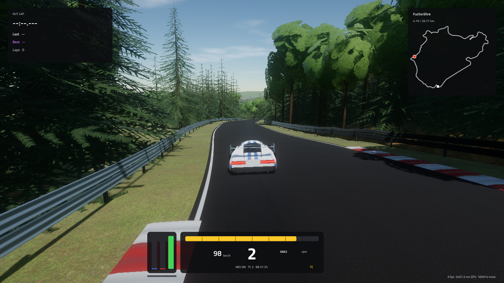
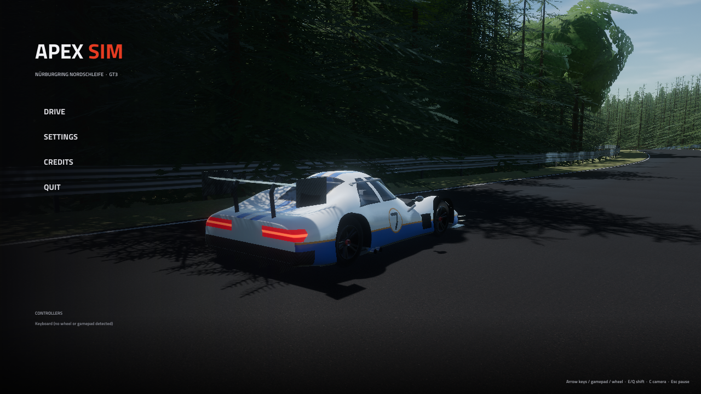
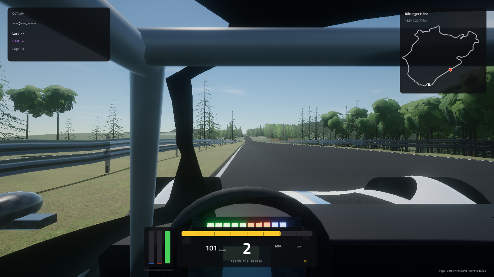
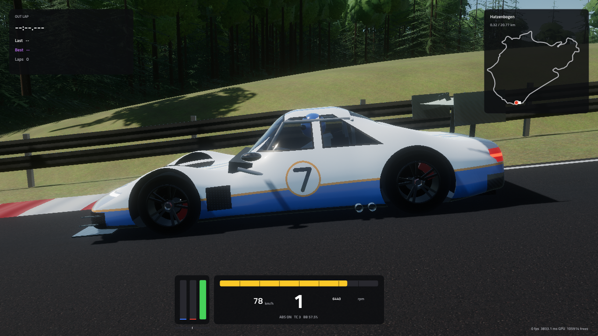
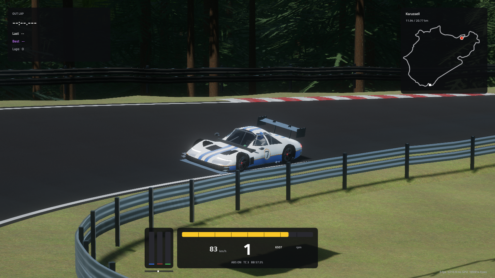

# ApexSim — Nordschleife GT3

A sim-racing game in modern C++20 / OpenGL 4.5, in the spirit of iRacing: one car (a GT3), one track
(the 20.8 km Nürburgring Nordschleife), and a focus on realistic handling, graphics and sound.



| | |
|---|---|
|  |  |
|  |  |

*Screenshots are from the software renderer used in CI-style testing (llvmpipe, 2× MSAA, 720p). On a
real GPU, use 4–8× MSAA, Ultra shadows and vegetation, and higher resolutions.*

## Features

**Track: the real Nordschleife.** The track is built from data, not drawn by hand.
- The centreline and all 42 named sections (Hatzenbach, Flugplatz, Fuchsröhre, Bergwerk, Karussell,
  Pflanzgarten, Döttinger Höhe, …) come from OpenStreetMap. Length is 20.77 km.
- Elevation comes from DEM terrain tiles: 300 m of climb from Breidscheid to Hohe Acht, including the
  Flugplatz crest and the Fuchsröhre compression.
- The real OSM forest/field/village map decides where ~100k spruce and beech trees grow.
- Road features: kerbs at every corner, the banked Karussell, double armco, grass verges, white lines,
  a rubbered-in racing line and the start/finish line.
- `tools/build_track.py` regenerates everything from source data.

**Physics** (fixed 1 kHz step, everything in double precision)
- 6-DOF chassis with four unsprung masses, springs, slow/fast bump & rebound dampers, bump stops,
  anti-roll bars, roll centres, camber and toe.
- Combined-slip Magic-Formula tyres with load sensitivity, a camber window, relaxation lengths
  (stable down to standstill) and self-aligning torque.
- 5.4 l V8 torque curve, engine inertia and engine braking. Clutch and diff are solved as friction
  constraints. Sequential 6-speed with ignition cut, auto-blip and money-shift protection.
  Clutch-pack LSD (preload + power/coast ramps).
- Aero: CdA 1.25, ClA 3.0 with balance; ~600 kg of downforce at 200 km/h.
- ABS, 6-level traction control and adjustable brake bias. Brake-disc temperature makes the discs glow.
- Steering torque is computed physically about each front kingpin, then passed through the 12.3:1 rack
  and the power steering to the column. This is what force feedback plays:
  - the tyres' aligning moment (pneumatic trail), which fades as the fronts pass their peak slip
    angle, so the wheel goes light when you understeer
  - caster trail
  - scrub radius, which turns left/right braking and kerb strikes into kickback
  - kingpin-inclination centring
  - contact-patch twist, which makes the wheel heavy when parked and frees up once rolling
  - the wheel goes light when the front wheels leave the ground (Flugplatz!)
- Validated by `apexsim_tests`: 0–100 km/h in 3.6 s, 0–200 in 9.2 s, 271 km/h top speed, 200–0 in
  ~80 m, ~1.7 g mid-speed grip, and a clean AI lap of the Nordschleife in ~7:44 (real GT3: ~7:00).
  Steering: ~17-28 Nm at the rim at the limit, ~13 Nm when parked.

**Graphics** (forward HDR renderer)
- PBR (GGX / Smith / Schlick), with a clear-coat lobe for car paint and carbon.
- Physically based atmosphere sky (Rayleigh/Mie) with a cumulus layer. Image-based lighting from the
  sky: prefiltered specular plus SH irradiance. Sun position for the real latitude and any time of day.
- Stabilised cascaded shadow maps (up to 4×4096²), height fog / aerial perspective, MSAA with
  tonemap-aware resolve, alpha-to-coverage foliage, bloom, ACES filmic tonemapping.
- Reversed-Z infinite projection and camera-relative rendering, so nothing jitters or z-fights
  anywhere on the 20 km circuit.
- CC0 photogrammetry PBR textures from Poly Haven (tarmac, grass, forest floor, gravel, bark).
- GPU heightmap terrain with LODs, a distant forest canopy shell and a 24 km horizon.
- Procedural GT3 coupé: wing, splitter, diffuser, livery with race number, glowing brakes, shift
  lights, a cockpit with a moving steering wheel and roll cage.

**Sound** (procedural, nothing sampled)
- Cross-plane V8: individual exhaust pulses per cylinder, using the real firing order, so each bank
  gets uneven pulses — the "burble" — feeding exhaust-pipe waveguides. Intake roar, mechanical noise,
  overrun crackle, limiter stutter and shift pops.
- Straight-cut gear whine and sequential clunks.
- Tyre squeal and scrub driven by the slip model, lock-ups, kerb rumble at the true ridge frequency,
  gravel/grass, road and wind noise, impacts and floor scrapes.
- Separate cockpit and exterior mixes, with a forest reverb.

**Game**
- Main menu with a live AI car lapping behind it.
- Practice sessions: lap timing, live delta to your best lap, four-wheels-off lap invalidation.
- HUD with rev lights, gear and speed, pedal and steering inputs, track map and the current corner name.
- Settings, saved to `settings.ini`:
  - graphics (resolution, window mode, MSAA, render scale, shadows, vegetation, FOV…)
  - audio mix
  - controls: rebind any key, button or axis; calibrate pedals; set wheel rotation for 1:1 steering;
    force feedback
  - assists
- Cameras: cockpit (with g-force head movement), hood, chase, far chase and TV.

## Building (Windows, for your RTX 5070 Ti)

**Easiest:** open the repository's **Actions** tab on GitHub, pick the latest run, and download the
`ApexSim-windows-x64` artifact. Unzip it and run `apexsim.exe`.

**From source:**
1. Install Visual Studio 2022 (with "Desktop development with C++") and CMake 3.21+ (VS includes one).
2. Run:
   ```
   git clone https://github.com/NoahMohsin44/iracing-clone.git
   cd iracing-clone
   cmake -S . -B build -A x64
   cmake --build build --config Release --parallel
   build\Release\apexsim.exe
   ```
   Dependencies (GLFW, GLM, Dear ImGui, miniaudio) are downloaded automatically by CMake on the first
   configure. Or open the folder in Visual Studio ("Open Folder") and pick the `apexsim.exe` target.

**Linux:** `sudo apt install libxrandr-dev libxinerama-dev libxcursor-dev libxi-dev libgl-dev`, then
`cmake -S . -B build -G Ninja -DCMAKE_BUILD_TYPE=Release && cmake --build build`.

**Physics tests:** `build/Release/apexsim_tests` (add `quick` to skip the full lap).
**Audio preview:** `apexsim_tests audio out.wav 1` renders a scripted run of the car audio to a WAV
file (`1` = cockpit mix, `0` = exterior).

## Controls (defaults, all rebindable)

| Action | Keyboard | Gamepad |
|---|---|---|
| Steer | ← → | left stick |
| Throttle / brake | ↑ / ↓ | RT / LT |
| Shift up / down | E / Q | A or RB / X or LB |
| Clutch | Z | – |
| Camera | C | Y |
| Look left / right / back | , / . / B | d-pad / R3 |
| Pause | Esc | Start |
| Reset car to track | R | Back |
| ABS / TC level | F7 / F8 | – |
| Brake bias + / − | ] / [ | d-pad up / down |
| HUD | H | – |
| Screenshot | F12 | – |

**Racing wheels** (Logitech, Thrustmaster, Fanatec, …):
1. Open *Settings → Controls*.
2. Click the *Wheel / controller* slot for **Steering**, turn the wheel fully right, then let go.
3. For each pedal, press it fully and release.
4. Set *Wheel rotation* to your wheel's range so steering is 1:1 with the car's 540° wheel.

**Force feedback** (Windows, DirectInput; any FFB wheel: Logitech, Thrustmaster, Fanatec, Moza, Simucube,
…). Like iRacing, there are no canned effects. The wheel plays the car's steering column torque from
the 1 kHz physics, buffered so none of the detail is lost between frames.
- **Strength** is the torque (Nm) that drives your wheel at 100 %. Lower values give stronger forces
  but more *clipping* (the signal flat-lining at 100 %). The yellow bar next to the pedals on the HUD
  turns red while clipping.
- After a lap, *Auto strength* sets it from the highest torque you saw.
- *Soft lock* stops the wheel at the car's 540° when your wheel can turn further.
- *Minimum force* helps gear and belt wheels with a dead spot in the centre.
- *Damping* adds weight on direct-drive wheels.
- Use *Test direction* once: the wheel should turn right, then left. If it doesn't, tick *Invert force
  direction*.
- The wheel goes limp in menus and when paused, and the game lets go of it when it loses focus.

**Field of view:** a realistic vertical FOV for one monitor is 35–45°. Change it in *Settings → Graphics*.

## Project layout

```
src/core      settings, input, force feedback, logging, paths, JSON, noise
src/world     track data and queries, track/terrain meshes, vegetation
src/car       tyre model, drivetrain, chassis physics, GT3 parameters, procedural car model
src/audio     DSP blocks, engine synth, car audio mix, audio device
src/gfx       GL wrappers, sky/IBL, shadows, post-processing, renderer
src/game      app loop, session, cameras, AI driver, lap timer
src/ui        theme, main menu, settings, HUD
assets/       shaders, textures, fonts, track data
tools/        build_track.py (OSM + DEM -> track data), fetch_textures.py
tests/        headless physics tests + audio preview renderer
```

## Data sources & licences

- Track layout, corner names and land cover: © OpenStreetMap contributors, ODbL 1.0.
- Elevation: AWS Terrain Tiles (Mapzen), derived from SRTM, EU-DEM and GMTED.
- Textures: Poly Haven, CC0.
- Font: Titillium Web, SIL OFL.
- Libraries: GLFW, Dear ImGui, GLM, miniaudio, stb, glad.

## Roadmap ideas

- Tyre temperatures and wear, fuel load, car setup screen.
- Replays, ghost car, AI opponents, the GP circuit / 24h combined layout.
- Hero car model from Blender (glTF import), recorded engine samples as an option, rain.
